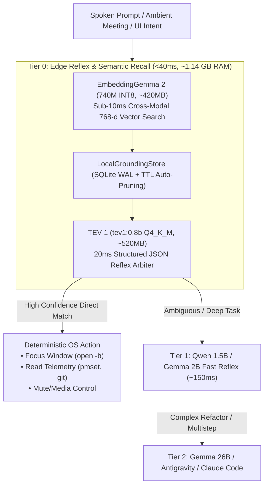

# ⚡ VoiceFi Tier 0 Edge Vector Grounding & Reflex Arbitration Guide
> **EmbeddingGemma 2 + TEV 0.8B On-Device Grounding Architecture on Apple Silicon**

---

## 🎯 Architecture Overview

VoiceFi features a **Three-Tier Edge Architecture** designed to deliver sub-40ms perception-to-action latency on Apple Silicon without burning cloud tokens or stressing unified memory:



---

## 🧠 Model Roles & Footprint Budget

| Tier Component | Model & Parameters | Resident RAM | Latency (Metal) | Core Responsibility |
| :--- | :--- | :--- | :--- | :--- |
| **Semantic Recall** | `embedding-gemma-2:740m` (INT8) | ~420 MB | ~3–8 ms TTFT | Converts text, code, and UI elements into normalized 768-d vectors. |
| **Reflex Arbiter** | `tev1:0.8b` (Q4_K_M) | ~520 MB | ~20–25 ms | Emits strict JSON actions (`{"action": "focus_window", "confidence": 0.90}`). |
| **Vector Cache** | `LocalGroundingStore` (SQLite WAL) | ~50 MB | <0.5 ms query | Ephemeral storage with automated TTL pruning (5m UI OCR, 30s clipboard). |
| **Combined Resident** | **Mixed INT8/INT4** | **~1.14 GB** | **<35 ms total** | Completely offline, 0 cloud tokens, duty cycle <1%. |

---

## 🛡️ Thermal & Headroom Guardrails (`ThermalSupervisor`)

Tier 0 is explicitly integrated into `voicefi.local.supervisor.ThermalSupervisor`:

1. **Memory Requirement**: Registered with `min_free_ram_gb: 0.8` (significantly lower than standard 2.5 GB LLM baselines).
2. **Thermal Reflex Exemption**:
   - `can_load_model(model_name, is_tier0=True)` permits Tier 0 executions under macOS `SERIOUS` thermal pressure.
   - Ensures the system remains capable of reporting battery status, muting audio, or warning the user (*"Mac running hot; offloading to cloud"*) even under heavy compiler loads.
   - Blocked only under `CRITICAL` thermal states to protect battery health.

---

## 🔒 Air-Gap Security & Privacy Choke Point

Screen OCR and clipboard vectorization present credential exposure risks if unvetted strings enter the embedding space.

* **Mandatory Redaction Choke Point**:
  All text must pass through `voicefi.redaction.redact_secrets()` **before** vectorization or database insertion:
  ```python
  from voicefi.redaction import redact_secrets

  safe_text = redact_secrets(raw_text)
  # sk-live-*, ghp_*, passwords replaced with [redacted]
  vector = engine.embed_text(safe_text)
  ```
* **Accessibility Exclusions**:
  Elements matching `AXSecureTextField` or windows belonging to password managers (1Password, Bitwarden, Keychain Access) are excluded from indexing.

---

## 🚀 Key Modules & Developer APIs

### 1. `EmbeddingEngine` (`src/voicefi/local/embed.py`)
Generates 768-dimensional normalized float vectors:
```python
from voicefi.local.embed import EmbeddingEngine

engine = EmbeddingEngine()
vec = engine.embed_text("Switch to Linear issue ENG-402", is_query=True)
# vec.shape == (768,), np.linalg.norm(vec) == 1.0
```

### 2. `LocalGroundingStore` (`src/voicefi/local/embed.py`)
Indexes ephemeral UI and context states with TTLs:
```python
from voicefi.local.embed import LocalGroundingStore

store = LocalGroundingStore()
store.index_entity(
    entity_type="window",
    bundle_id="com.linear",
    title="Linear - Issue ENG-402",
    text_content="Linear issue ENG-402 discussing ThermalSupervisor throttle threshold",
    ttl_seconds=300,
)

results = store.search("Linear ticket", top_k=1, min_similarity=0.72)
```

### 3. `Tier0ReflexArbiter` (`src/voicefi/local/embed.py`)
Evaluates vector candidates and arbitrates direct OS dispatch vs. escalation:
```python
from voicefi.local.embed import Tier0ReflexArbiter

arbiter = Tier0ReflexArbiter(store=store)
action = arbiter.arbitrate("Switch to Linear ticket")
# Tier0Action(action='focus_window', bundle_id='com.linear', escalate=False)
```

### 4. Foresight Ambient Intelligence (`cmd_ambient`)
During ambient meetings (`vg ambient start`), spoken VAD clauses are matched in real time against the grounding store, printing non-intrusive HUD chips for relevant local files and tickets without interrupting conversation.

---

## 🧪 Verification & Testing

Run the full Tier 0 test suite:
```bash
pytest tests/test_tier0_embed.py -v
```
Verifies normalization, air-gap secret scrubbing, TTL eviction, direct reflex execution, thermal exemptions, and agent escalation boundaries.
